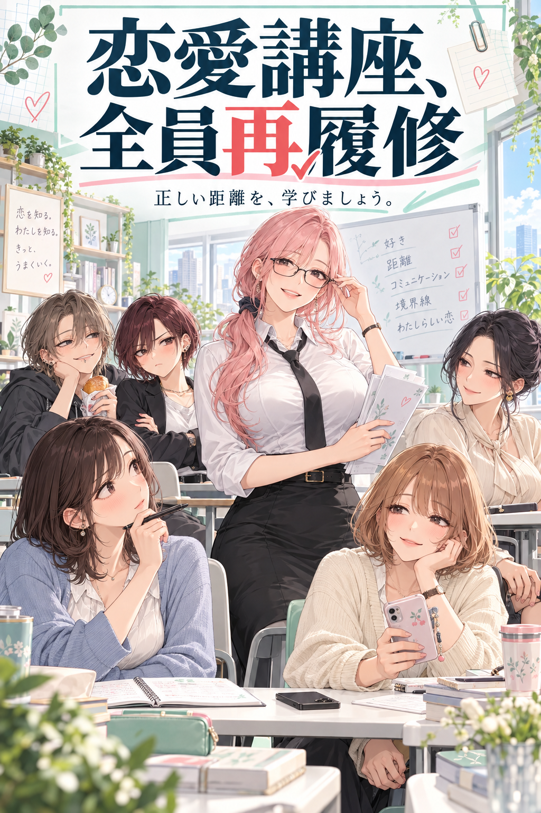

# 恋愛講座、全員再履修

重すぎる女たちが「健全な恋愛」を学び、学んだことを盛大に間違えて使う、オリジナルの恋愛群像コメディ。

百合を中心に、危ない生活圏の女性・灰原カナの物語も育てる創作リポジトリです。設定資料と本編の初稿を収録しています。

## 本編

- [第一話　先生、今の方は？](chapters/001.md)（初稿）
- [第二話　お店は、お店だから](chapters/002.md)（初稿）
- [第三話　断っても、嫌いになりません](chapters/003.md)（初稿）
